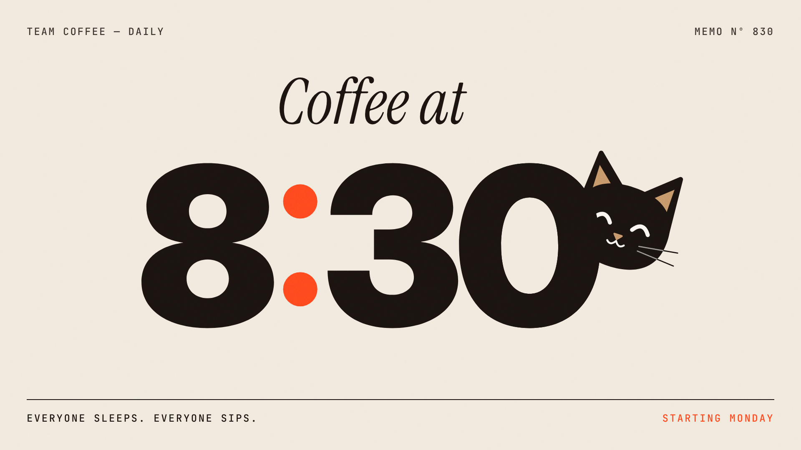

# Coffee at 8:30

A 30-second, 16:9, 60 fps motion piece arguing that team coffee should move from 8:15 to 8:30,
so the late birds who sleep in don't turn into sad little cats.



| Deliverable | Path |
|---|---|
| Final video (1920×1080, 60 fps, H.264 + AAC) | `out/final.mp4` |
| Poster frame (28.5s) | `out/poster.png` |
| Contact sheet (every 0.5s) | `out/contact.png` |
| **Version française** : vidéo, poster, planche contact | `out/fr/final.mp4`, `out/fr/poster.png`, `out/fr/contact.png` |
| Style guide | `docs/style_guide.md` |
| Shot list / storyboard | `docs/shotlist.md` |

## Story in six shots

| Time | Shot | Idea |
|---|---|---|
| 0–4 | **Hook** | A giant `8:15` punches in. A red pen strikes it out and the digits fall away |
| 4–9 | **Clock** | The colon becomes the clock pivot: *too early.* A red wedge marks the missing 15 minutes |
| 9–15 | **Cups** | The team sips at 8:15. The live clock runs to 08:30 and every cup is empty. Ears appear at the reserved seat |
| 15–20 | **Sad cat** | The camera pushes in: late birds *become sad little cats.* The ears droop and a tear falls |
| 20–24.5 | **Punch** | Full red: `JUST WAIT 15 MIN.`, one word every other beat |
| 24.5–30 | **Lockup** | `15` rolls to `30` → *Coffee at* **8:30**. A happy cat peeks out from behind the 0 |

## How it's built

- **`src/main.js`**: a Canvas 2D renderer where every frame is a pure function of time.
  `window.seek(t)` always draws the same pixels. There are no timers, no `Math.random`, no CSS animation, and
  no state carried between frames. I verified this: frames rendered in different orders and by different
  workers have identical MD5 hashes.
- **Springs**: an analytic damped-oscillator solution with four motion weights (UI, cards, hero type,
  camera), plus a punch spring and a heavy spring. See `docs/style_guide.md`.
- **Motion blur**: each output frame averages 6 sub-frames over a 180° shutter. Sub-samples are clamped to
  their own shot, so hard cuts stay hard.
- **`src/timeline.json`**: the single source of truth for duration, shot boundaries and every cue time, shared by the
  visuals, the audio and the renderer. To retime the film, edit this file only.
- **`scripts/audio.py`**: a numpy synth that builds a 120 BPM score (Fmaj9 → Em9 → Am9 → Dm9 → Fm6 → G7 → Cmaj9)
  plus SFX on the cues: slash, ratchet, ceramic clinks, sips, mew, tear drop, bell. Because every sound is
  placed from the same cue file, sync is exact by construction. Onset autocorrelation on the rendered mix
  recovers 120.0 BPM, with onsets on the beats. Loudness is about −15 LUFS.
- **`scripts/render.mjs`**: serves the repo locally, drives headless Chromium with Playwright across 4
  parallel pages, and writes PNG frames.
- **`scripts/build.sh`**: frames → audio → `ffmpeg` (x264 CRF 12, yuv420p, BT.709) → contact sheet + poster.

## Run it

```bash
npm install            # playwright (or use a global install; the script falls back to it)
npm run build          # ≈4 min on 4 cores (npm run build -- fr for French) -> out/final.mp4, out/poster.png, out/contact.png
npm run preview        # open http://localhost:8080/src/index.html and scrub with the slider
                       # add ?t=17 to jump to a timestamp
```

Requirements: Node 18+, Python 3 with numpy and Pillow, and ffmpeg.

## Quality loop log

Each round: full render → contact sheet plus full-resolution crops and transition filmstrips → score → fix the top 3.

| Round | Hook | Comp. | Read. | Motion | Trans. | Variety | Consist. | Sound | Top problems fixed |
|---|---|---|---|---|---|---|---|---|---|
| 1 | 8 | 7 | 7 | 7 | 7 | 8 | 8 | 8 | The dive smeared through the clock hands; the drooped ears read as bat wings and the sad cat looked grumpy; WAIT collided with JUST and the 15→30 hand-off was a pile-up |
| 2 | 8 | 7.5 | 7.5 | 8 | 7.5 | 8 | 8 | 8 | Dead middle band in the cups shot (bigger cups, added a big live clock); the iris blot swallowed the digits too early; the end hold froze |
| 3 | 8.5 | 8 | 8 | 8 | 7.5 | 8.5 | 8.5 | 8 | The saucer tilted with the cup; foam whiskers turned into stray grey lines on paper; the tear covered the eye; lockup optical balance with the cat; boomy sub-bass and quiet ticks in the mix |
| 4 | 8.5 | 8 | 8.5 | 8 | 8.5 | 8.5 | 8.5 | 8 | The first frame of the red shot was empty; the "8" overshot into "30" (now critically damped); a blank beat after the dive |

### v2: 30s re-pace

Feedback on v1 was that it was too fast. v2 keeps the same six shots and stretches the film to 30s:
- Every hard-coded time moved into `timeline.json`, and the cues are now spaced roughly ×2.
- Springs keep their physical speed. The extra time becomes reading holds, not slow motion.
- The punch words land every other beat.
- The score was re-arranged to the new shot lengths: the same progression, stabs repeating per bar, and a soft outro.
- To keep the longer holds alive, I added a beat-stepping red second hand on the clock, a slow push, cat breathing and two blinks.

### Version française

Chaque texte vit dans la table `TEXT` en haut de `src/main.js` (`en` / `fr`). La langue se choisit avec `?lang=fr`
dans l'aperçu, ou avec `npm run build -- fr` (sortie dans `out/fr/`). Les lignes plus longues en français
sont réduites automatiquement pour tenir dans leur colonne (option `maxW`). L'animation, le rythme et la bande-son
sont identiques à la version anglaise.

Textes : *8:15* → *trop tôt.* / *pour ceux qui font la grasse mat'.* → *L'équipe prend le café à 8 h 15.* →
*À 8 h 30, plus une goutte.* → *Les lève-tard deviennent de tristes chatons.* (carton : *ATTENDONS 8:30*) →
*ON ATTEND 15 MIN.* → *Café à 8:30* / *Tout le monde dort. Tout le monde a son café. — Dès lundi*.

## Notes

- `./refs/` was empty, so `docs/style_guide.md` is an original art direction rather than an analysis of references.
- Fonts are all SIL OFL: Inter Display (Rasmus Andersson), Instrument Serif, and JetBrains Mono. They're bundled in `assets/fonts/`.
- Only 16:9 was requested. For other formats, recompose them in `computeLayouts()` and in the per-shot coordinates rather than cropping.
